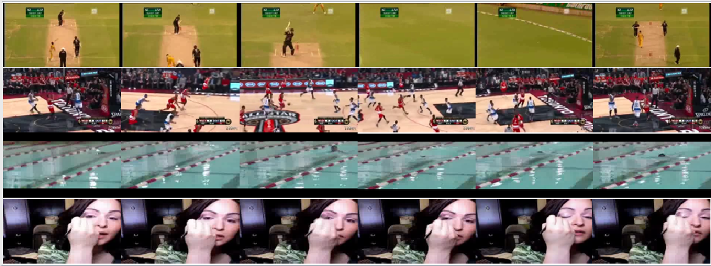
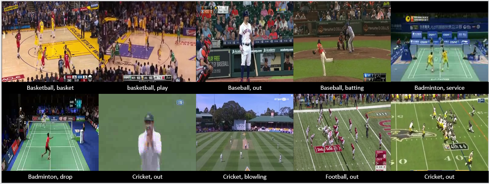

# SP-2 Dataset and RICAPS: A Comprehensive Framework for Broadcast Sports Video Classification

[](https://github.com/abdkhanstd/Sports2)
[](https://dl.acm.org/doi/10.1145/3444685.3446316)
[](https://tensorflow.org/)
[](README.md)
[](README.md)

## Abstract

This repository introduces two interconnected contributions to the field of sports video analysis: the SP-2 dataset, a meticulously curated collection of broadcast sports video clips, and RICAPS (Residual Inception and Cascaded Capsule Network), a novel deep learning architecture designed specifically for fine-grained sports video classification. These contributions address a fundamental gap in sports video understanding by distinguishing between amateur and professionally broadcast sports content—a critical distinction that has been largely overlooked in existing research.

The exponential growth of video content on platforms such as YouTube, Facebook, and Youku has created unprecedented demand for automated content analysis systems. Within this landscape, sports videos represent one of the most engaging yet challenging categories for machine learning applications. Sports enthusiasts' insatiable appetite for timely updates and highlights has catalyzed the development of sophisticated video summarization techniques, yet existing datasets fail to capture the unique characteristics of broadcast sports footage.

Our work fundamentally reframes sports video analysis by recognizing that broadcast sports videos exhibit distinct visual and temporal properties compared to amateur sports recordings. This recognition led to the development of SP-2, a comprehensive dataset containing over 23,000 video clips spanning 14 sports categories, each annotated with sports type, playfield scenarios, and game actions. Complementing this dataset, RICAPS introduces an innovative neural architecture that leverages residual inception modules and cascaded capsule networks to achieve state-of-the-art classification performance.

## Research Motivation and Novelty

### The Critical Gap in Sports Video Understanding

Existing sports video datasets suffer from a fundamental conceptual limitation: they treat all sports videos as homogeneous entities, failing to distinguish between the radically different characteristics of amateur recordings and professionally broadcast content. This oversight has significant implications for algorithm development and real-world deployment scenarios.

Amateur sports videos, typically characterized by egocentric perspectives and limited camera movements, present fundamentally different computational challenges compared to broadcast footage. Professional sports broadcasting employs sophisticated multi-camera systems with rapid scene transitions, dynamic zoom operations, and complex visual compositions that create unique temporal discontinuities rarely encountered in amateur recordings.

### Broadcast Sports Video Characteristics


*Comparative analysis of broadcast sports footage (top rows) versus amateur sports videos (bottom). Note the rapid camera transitions, sophisticated zoom dynamics, and temporal discontinuities characteristic of professional broadcasting*

Professional broadcast sports videos demonstrate several distinctive properties that challenge conventional video analysis approaches:

**Temporal Discontinuity**: Camera perspectives change rapidly, often within seconds, creating significant frame-to-frame visual disparities that complicate traditional temporal modeling approaches.

**Multi-Camera Orchestration**: Professional broadcasts seamlessly integrate footage from multiple camera angles, each capturing different spatial perspectives and zoom levels that require sophisticated feature extraction techniques.

**Dynamic Visual Composition**: Professional camera operators employ complex panning, tilting, and zooming operations that create continuously varying visual perspectives throughout the broadcast sequence.

**Integrated Graphics and Overlays**: Broadcast content includes sophisticated graphical overlays, scoreboard information, and marketing elements that introduce additional visual complexity requiring robust feature extraction mechanisms.

These characteristics necessitate specialized algorithmic approaches that can handle the unique challenges posed by broadcast sports content while maintaining robust performance across diverse sports categories and viewing scenarios.

## SP-2 Dataset: Comprehensive Broadcast Sports Collection

### Dataset Composition and Scope

The SP-2 dataset represents an unprecedented collection of broadcast sports video content, encompassing **23,000+ video clips** extracted from full-length professional sports broadcasts. Each clip maintains authentic broadcast characteristics while providing focused segments suitable for machine learning applications.


*Representative samples from SP-2 dataset illustrating sports category diversity, playfield scenarios, and game action annotations*

Our systematic data collection methodology prioritized ecological validity by preserving the authentic visual and temporal characteristics of broadcast sports content. Video clips were extracted from diverse broadcasting networks and sports seasons to ensure broad generalizability across different production styles and technical specifications.

### Comprehensive Statistical Analysis

The dataset demonstrates careful stratification across multiple sports categories, ensuring balanced representation while accommodating the natural variability in game duration and action frequency across different sports.

| Sport Category | Groups | Total Videos | Avg Videos/Group | Total Duration (min) | Avg Duration (sec) | Action Classes |
|----------------|--------|--------------|------------------|---------------------|-------------------|----------------|
| Cricket | 13 | 1,773 | 136.4 | 9,785.1 | 5.5 | batting, bowling, run, out, event |
| Football | 10 | 1,613 | 161.3 | 11,693.1 | 7.2 | play, goal, foul |
| Soccer | 14 | 1,554 | 111.0 | 14,254.3 | 9.2 | play, goal, foul |
| Basketball | 12 | 1,790 | 149.2 | 14,186.2 | 7.9 | play, goal, foul |
| Baseball | 10 | 1,619 | 161.9 | 12,063.7 | 7.5 | batting, bowling, run, out, event |
| Rugby | 10 | 1,616 | 161.6 | 9,346.3 | 5.8 | play, goal, foul |
| Tennis | 12 | 2,062 | 171.8 | 11,558.3 | 5.6 | play, drop, service |
| Handball | 11 | 1,766 | 160.5 | 12,468.0 | 7.1 | play, goal, foul |
| Snooker | 10 | 1,376 | 137.6 | 8,727.3 | 6.3 | shot, pocket, aiming |
| Volleyball | 10 | 1,654 | 165.4 | 12,944.2 | 7.8 | play, drop, service |
| Ice Hockey | 10 | 1,751 | 175.1 | 10,510.1 | 6.0 | play, goal, foul |
| Hockey | 10 | 1,652 | 165.2 | 11,080.1 | 6.7 | play, goal, foul |
| Badminton | 13 | 1,532 | 117.8 | 9,333.5 | 6.1 | play, drop, service |
| Table Tennis | 10 | 1,267 | 126.7 | 7,786.8 | 6.1 | play, drop, service |

### Annotation Framework and Methodology

The SP-2 dataset employs a sophisticated three-tier annotation schema designed to capture the multi-dimensional nature of sports video content:

**Sports Category Classification**: Each video clip receives primary sport identification enabling high-level categorization and sport-specific algorithm development.

**Playfield Scenario Recognition**: Detailed annotations capturing the contextual setting and environmental conditions present in each video segment.

**Game Action Labeling**: Fine-grained action classifications specific to each sport, enabling precise temporal event recognition and highlight generation applications.

This comprehensive annotation framework enables researchers to develop algorithms at multiple levels of granularity, from broad sport recognition to fine-grained action detection, while maintaining consistency across the entire dataset.

## RICAPS: Advanced Neural Architecture for Sports Classification

### Architectural Innovation and Design Philosophy

RICAPS (Residual Inception and Cascaded Capsule Network) represents a novel deep learning architecture specifically engineered to address the unique challenges presented by broadcast sports video classification. The architecture demonstrates innovative integration of residual learning principles, inception modules, and capsule network components to achieve robust feature extraction and classification performance.

The network design philosophy emphasizes the capture of both spatial and temporal dependencies while maintaining computational efficiency suitable for real-time applications. By combining the representational power of inception modules with the spatial relationship modeling capabilities of capsule networks, RICAPS achieves superior performance across diverse sports categories and viewing conditions.

### Technical Implementation Framework

**Residual Inception Modules**: The foundation of RICAPS employs modified inception architectures incorporating residual connections to enable effective gradient propagation while capturing multi-scale spatial features essential for sports scene understanding.

**Cascaded Capsule Integration**: The latter stages of the network utilize sophisticated capsule network components arranged in cascaded configurations to model complex spatial relationships and viewpoint variations characteristic of broadcast sports footage.

**Feature Extraction Pipeline**: The complete architecture implements a carefully designed feature extraction pipeline optimized for the temporal and spatial characteristics of broadcast sports content, achieving state-of-the-art classification accuracy while maintaining computational efficiency.

## Implementation Guide and Technical Requirements

### System Dependencies

**Core Framework Requirements**:
```bash
pip install -r requirements.txt
```

**Essential Dependencies**:
- TensorFlow >= 1.0
- Keras >= 2.0
- FFmpeg (for video processing)
- NumPy, OpenCV, Matplotlib

### Dataset Preparation Protocol

**Directory Structure Setup**:
```bash
mkdir data/train data/test data/sequences data/checkpoints
```

**Video Processing Pipeline**:
1. Extract dataset archive to `data/` directory
2. Configure FFmpeg path in `data/2_extract_files.py`
3. Execute feature extraction: `python extract_features_IR.py`
4. Run training pipeline: `python Train_IR_2.py`

### Training and Evaluation Framework

The repository provides comprehensive training and evaluation scripts designed to facilitate reproducible research and fair comparison with existing methodologies. The training pipeline incorporates sophisticated data augmentation techniques and regularization strategies optimized for sports video classification tasks.

**Critical Implementation Note**: The dataset organization maintains strict separation between videos from the same broadcast group across training and testing splits. This methodology prevents data leakage and ensures realistic performance evaluation reflecting true generalization capabilities.

## Data Access and Distribution

### Primary Dataset Access
**Complete SP-2 Dataset** (~10 GB):
- [Primary Download Link](http://sp2.uk.to/SP2%20(SPNet%20and%20Enet).rar)

**Alternative Access**: Due to hosting limitations, researchers experiencing download difficulties should contact `abdkhan@163.com` with specific access requirements and proposed sharing mechanisms.

### Train/Test Split Protocols

Official train/test partitions are provided in the "List" folder, generated using stratified random sampling while maintaining group-level separation. This approach ensures that videos extracted from the same broadcast source remain exclusively within either training or testing partitions, preventing artificial performance inflation through data leakage.

## Research Applications and Future Directions

The SP-2 dataset and RICAPS architecture enable diverse research applications spanning sports analytics, video summarization, and automated content generation. The comprehensive annotation framework supports investigations into multi-modal learning approaches combining visual, temporal, and contextual information streams.

**Immediate Applications**:
- Automated sports highlight generation using sport category and playfield scenario annotations
- Real-time sports classification for broadcast content management
- Cross-sport generalization studies leveraging the diverse category representation

**Future Research Opportunities**:
- Integration with temporal action localization frameworks for precise event detection
- Development of sport-specific summarization algorithms utilizing fine-grained action annotations
- Investigation of transfer learning approaches across related sports categories

## Citation and Academic Attribution

When utilizing the SP-2 dataset or RICAPS methodology, please acknowledge our contributions using the following citation:

```bibtex
@inproceedings{khan2021ricaps,
  title        = {RICAPS: residual inception and cascaded capsule network for broadcast sports video classification},
  author       = {Khan, Abdullah Aman and Tumrani, Saifullah and Jiang, Chunlin and Shao, Jie},
  booktitle    = {Proceedings of the 2nd ACM International Conference on Multimedia in Asia},
  pages        = {1--7},
  year         = {2021},
  organization = {ACM},
  doi          = {10.1145/3444685.3446316}
}
```

## Acknowledgments and Collaborative Contributions

We extend our sincere appreciation to Mr. Waqas Amin, Tahseen Khan, and the broader community of sports enthusiasts who contributed to video location, extraction, and annotation processes. Additionally, we acknowledge harvitronix for providing foundational code components that facilitated our implementation.

Special recognition goes to the collaborative effort required for large-scale video dataset creation, involving coordination across multiple institutions and technical infrastructure providers who enabled the comprehensive data collection and processing pipeline.

## Contact and Technical Support

**Primary Contact**: Abdullah Aman Khan  
**Email**: `abdkhan@163.com`

For technical inquiries, implementation support, or collaborative research opportunities, please reach out through the provided contact information. We welcome contributions from the research community and encourage researchers to share methodological innovations and performance improvements developed using our resources.

---

**Implementation Note**: The current repository contains core RICAPS implementation and SP-2 dataset access. Playfield and view annotations are intentionally withheld pending additional validation studies. Future releases will include expanded annotation coverage and reference implementation for baseline comparison methods.

**Version Information**: This documentation refers to SP-2 Version 1. Researchers should note that SP-2 Version 2 incorporates minor modifications detailed in the SPNet repository for enhanced compatibility with recent deep learning frameworks.
